<picture>
  <source media="(prefers-color-scheme: dark)" srcset="https://raw.githubusercontent.com/yuri-infra/fused-cuda-triton-inductor/main/assets/hero-dark.svg?v=4">
  <source media="(prefers-color-scheme: light)" srcset="https://raw.githubusercontent.com/yuri-infra/fused-cuda-triton-inductor/main/assets/hero-light.svg?v=4">
  
</picture>

<p align="center">
  <a href="https://yuri-infra.github.io/#kernels"><strong>⚡ Live Lab ↗</strong></a> &nbsp;·&nbsp;
  <a href="#system-architecture"><strong>Architecture</strong></a> &nbsp;·&nbsp;
  <a href="benchmarks/local_gpu_benchmark_report.md"><strong>Benchmarks</strong></a> &nbsp;·&nbsp;
  <a href="tests/test_all.py"><strong>Tests (8/8)</strong></a> &nbsp;·&nbsp;
  <a href="csrc/fused_add_rmsnorm_cuda.cu"><strong>CUDA (.cu)</strong></a> &nbsp;·&nbsp;
  <a href="https://github.com/yuri-infra"><strong>← Profile</strong></a>
</p>

<p align="center">
  <code>CUDA C++ (.cu)</code> &nbsp;<code>OpenAI Triton 3.7</code> &nbsp;<code>PyTorch 2.x Inductor</code> &nbsp;<code>Core ATen IR</code> &nbsp;<code>c10::Dispatcher</code> &nbsp;<code>RTX 5060 sm_120</code>
</p>

# fused-cuda-triton-inductor · PyTorch 2.x Inductor ATen 图重写与 CUDA C++ / Triton 算子库

本工程针对大模型推理与训练中的两类算子及编译问题提供可复现、带编译期/运行期双重硬计数核验的实现：
1. **训练侧跨 GEMM 与大词表规约显存瓶颈（`Fused Linear + Cross-Entropy`）**：原生 `torch.compile` 无法跨越 cuBLAS 矩阵乘融合 12.8 万~15.2 万词表交叉熵损失，仍需物化完整 `[B*S, Vocab]` 张量；本工程通过分块矩阵乘 + Triton Online-Softmax 原位求导消除 `[M, V]` 中间张量，并针对 FP16 设计 `2^-4` 指数移位预缩放与尾端寄存器 FP32 延迟归一化，杜绝大词表非目标词梯度下溢归零。
2. **推理侧 TorchInductor `post_grad` 图算融合与纯 C++ 算子注册**：面向推理图（`torch.inference_mode()` / `torch.no_grad()`），基于 `torch._inductor.pattern_matcher` 在 Core ATen IR 层覆盖主流 RMSNorm 方言（含 HuggingFace 官方 `Qwen2RMSNorm` / `LlamaRMSNorm` 及原生 `F.rms_norm`）、异构头 GQA Q+K RoPE 与 SwiGLU，并通过 `TORCH_LIBRARY_IMPL(ai_infra, CUDA, m)` 将 `.cu` 算子直接注册至 `c10::Dispatcher` 以消除 Python 回调税。

---

## System Architecture

<picture>
  <source media="(prefers-color-scheme: dark)" srcset="https://raw.githubusercontent.com/yuri-infra/fused-cuda-triton-inductor/main/assets/arch-dark.svg?v=4">
  <source media="(prefers-color-scheme: light)" srcset="https://raw.githubusercontent.com/yuri-infra/fused-cuda-triton-inductor/main/assets/arch-light.svg?v=4">
  
</picture>

---

## 1. 目录结构

```text
fused-cuda-triton-inductor/
├── README.md
├── csrc/
│   └── fused_add_rmsnorm_cuda.cu             # 原生 CUDA C++：FP16/BF16/FP32 uint4 128-bit 向量化、单 Pass 寄存器驻留、TORCH_LIBRARY_IMPL 注册
├── ai_infra_fused_ops/
│   ├── __init__.py
│   ├── cuda_ext.py                           # nvcc 扩展自动构建、PTX 前向兼容与 cuobjdump 汇编指令统计器
│   ├── kernels.py                            # Triton 算子集：防下溢 Fused Linear+CE、双向广播安全 GQA RoPE、SwiGLU、RMSNorm
│   ├── custom_ops.py                         # CustomOp Schema / Meta 推导 + C++ 原子计数与 Python 运行期计数汇总
│   └── compiler_pass.py                      # 推理专用两阶段 post_grad ATen 重写、动态传递闭包防死环、CustomGraphPass 缓存隔离
├── tests/
│   └── test_all.py                           # 8 项严格测试（含广播防越界、双 cos 交叉依赖防死环、FP16 防下溢、真实 Qwen2.5 权重与缓存隔离）
└── benchmarks/
    ├── bench_suite.py                        # 5 轮 ABA 交替中位数评测脚本（含修正梯度清零基线与 256MB 持续 D2D 带宽测量）
    └── local_gpu_benchmark_report.md         # 本机实测生成的性能对比、Roofline 与 PTX 指令核验报告
```

---

## 2. 运行与验证命令

```bash
cd fused-cuda-triton-inductor

# 1. 编译 .cu 扩展并运行全部 8 项严格单测与红方回归测试
python3 tests/test_all.py

# 2. 运行 5 轮 ABA 交替中位数 Benchmark 并生成报告
python3 benchmarks/bench_suite.py
```

---

## 3. 核心工程要点与实测边界说明

### 3.1 推理图两阶段 `post_grad` 重写与动态传递闭包防死环
- **适用范围**：`with inductor_fusion_pass():` 基于 `pm.fwd_only` 构建并自动跳过含 `tangent` 占位符的反向图，仅面向推理图；通过继承 `CustomGraphPass`（`uuid() -> None`）隔离 `FXGraphCache` 并在异常退出时自动恢复全局配置。
- **多方言覆盖**：同时匹配显式 FP32 权重提升、HuggingFace 官方 `Qwen2RMSNorm` / `LlamaRMSNorm`（先 `.to(input_dtype)` 再乘 `weight`）以及 PyTorch 原生 `F.rms_norm`（2D/3D），已在本地 `Qwen2.5-0.5B-Instruct` 真实 `safetensors` 权重上通过编译与运行期双计数验证（`test_07`）。
- **动态传递闭包防死环**：针对多层共享 `(cos, sin)` 甚至多组 `(cos_a, cos_b)` 交叉依赖（`A(a)->D(b), C(b)->B(a)`）场景，Stage 2 每次横向合并一对兄弟 `rope_single` 后立即执行 `pm.stable_topological_sort(graph)` 并重算全图祖先位掩码 `anc_mask`，确保合并产生的新传递路径实时生效，从图论上杜绝有向死环（`test_06`）。

### 3.2 原生 CUDA C++ (`.cu`)、Triton 与原生 `torch.compile` 的实测表现（无夸大对照）
所有数据均以 [local_gpu_benchmark_report.md](benchmarks/local_gpu_benchmark_report.md) 的 **5 轮 ABA 交替中位数**为准：
- **`Fused Linear + Cross-Entropy`（`M=4096, H=1024, Vocab=128,256`, BF16 前反向）**：清空 Warmup 梯度后再记录基线显存（叶子梯度固定占 `258.5 MB`），原生 `torch.compile` 总峰值增量为 `1260.5 MB`（纯中间激活 `1002.0 MB`），本方案降至 `517.0 MB`（纯中间激活 `258.5 MB`，节省 `59.0%` 总增量 / `74.2%` 中间激活），`chunk_size=1024` 下耗时与原生 `compile` 持平（`115.35 ms` vs `114.22 ms`, `0.99x`；较 Eager `1.11x`）。FP16 下通过 `2^-4` 预缩放将 `w.grad` 零元素占比从提前缩放的下溢态（`>96%`）恢复至理论精度极限（`~11%`）。
- **单算子 `Add + RMSNorm` 与 GQA RoPE**：`.cu` 实现覆盖 FP16/BF16/FP32 的 `uint4` 128-bit 向量化与对齐维度单 Pass 寄存器驻留（经 `cuobjdump --dump-ptx` 核验含 `80` 处 `v4.u32` 向量加载与 `140` 处 `shfl.sync.bfly`）。在 `M=1` FP16 下 `.cu` 为 `13.8 us`（原生 `compile` `14.8 us`, `1.07x`），`M=8` FP16 下为 `14.6 us`（原生 `compile` `13.4 us`, `0.92x`），大尺寸 `[4096, 4096]` FP16/FP32 与 `[16384, 4096]` 下三者均收敛至本机实测持续 D2D 带宽上限（`~312.6 GB/s`）的 `98%~100%`。单次发射 Triton GQA RoPE 在 `B=1, S=1` 下相对原生 `compile` 为 `1.40x`（`11.6 us` vs `16.2 us`），`B=8, S=1` 与 `B=2, S=1024` 与原生 `compile` 持平（`0.99x` / `1.02x`）。
- **8 层 LLaMA-3 Stack 整网 ABA 中位数**：在注意力与矩阵乘占主导的 8 层整网中，将 17 次 RMSNorm 迁移至 C++ `TORCH_LIBRARY_IMPL` 后（其余 16 次 Triton 算子仍经 Python `@torch.library.impl` 分发），5 轮 ABA 中位数相对原生 `torch.compile` 在 `B=1, S=1`、`B=8, S=1`、`B=2, S=512` 下分别为 `0.96x`（`2.829 ms` vs `2.726 ms`）、`1.03x`（`2.864 ms` vs `2.956 ms`）与 `1.01x`（`26.211 ms` vs `26.397 ms`），相对 Eager 提速 `1.12x ~ 2.40x`。
